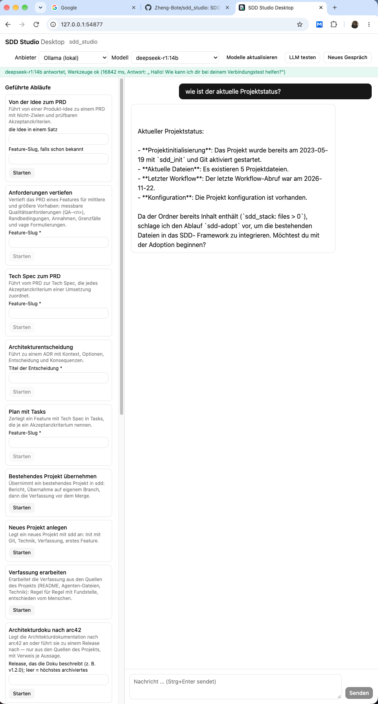

# SDD Studio (`sdd`)

Sprachneutrales CLI-Werkzeug (`sdd`) und Go-Kernbibliothek (`internal/sddcore`) zur maschinellen Durchsetzung von **Spec-Driven Development** (`sdd_process_3`) über einen gemeinsamen, selbstprüfenden Regelkatalog und ein eingebettetes Handbuch. Dazu kommt der optionale KI-Desktop **`sdd-desk`**, der im Gespräch durch den Prozess führt.

## Leitprinzip

> Es gibt **einen Regelkatalog** ([`catalog/catalog.yaml`](catalog/catalog.yaml)). Das [Handbuch](handbuch/03-mechanismen.md) erklärt ihn, das Programm setzt ihn durch. Beide sind Ausgaben derselben Quelle — und diese Quelle wird über `SDD-070` bis `SDD-073` maschinell geprüft.

`sdd` selbst ist **KI-frei und offline** ([ADR 0003](docs/adr/0003-ki-desktop-darf-alle-sdd-aktionen-mit-freigabe.md), löst ADR 0002 ab): Kern, CLI, `sdd ui` und `sdd mcp` enthalten keinen LLM-Code und bauen keine Netzwerkverbindung nach außen auf.

Architekturüberblick nach arc42: [`docs/arc42.md`](docs/arc42.md).

---

<!-- START doctoc generated TOC please keep comment here to allow auto update -->

<details>
<summary>Table of Contents</summary>

- [Leitprinzip](#leitprinzip)
- [Stand](#stand)
  - [Regeln](#regeln)
- [Bauen](#bauen)
  - [Alles bauen und lokal installieren (Linux und macOS)](#alles-bauen-und-lokal-installieren-linux-und-macos)
- [`sdd` — Kommandos](#sdd-kommandos)
  - [CI](#ci)
  - [Agenten (MCP)](#agenten-mcp)
- [KI-Desktop `sdd-desk` (optional)](#ki-desktop-sdd-desk-optional)
  - [Als Desktop-Anwendung (Tauri v2)](#als-desktop-anwendung-tauri-v2)
  - [Als lokale Web-Oberfläche: bauen](#als-lokale-web-oberflache-bauen)
  - [Modelle einrichten](#modelle-einrichten)
  - [Starten](#starten)
  - [Was der Desktop darf](#was-der-desktop-darf)
  - [Agenten-CLIs als Antrieb](#agenten-clis-als-antrieb)
- [Tests](#tests)
- [Nächste Schritte](#nachste-schritte)
- [Diskussion](#diskussion)
  - [Was die Kombination trägt — und was `sdd` davon übernimmt](#was-die-kombination-tragt-und-was-sdd-davon-ubernimmt)
  - [Der Ablauf für ein Projekt mit BMAD-Vorgeschichte](#der-ablauf-fur-ein-projekt-mit-bmad-vorgeschichte)

</details>

<!-- END doctoc generated TOC please keep comment here to allow auto update -->

---

## Stand

Letzte Version: **0.11.0** ([CHANGELOG](CHANGELOG.md)) — Regelkatalog `1.3.0` mit 26 Regeln. Neu in 0.11.0: **Bauen und Installieren auf Linux und macOS** — `make` erkennt das System, auf macOS entsteht ein startbares `.app`-Bundle, `make install` kopiert es nach `~/Applications`. Aus 0.10.0: **Agenten-CLIs als Antrieb** — `sdd-desk` wird für `claude` und `codewhale` zum MCP-Proxy, jeder Werkzeugaufruf eine Freigabekarte. Aus 0.9.1: **Security Hardening, MCPClient-Lifecycle & Clean Code** (`POST /api/open` gegen Symlink-Pfadflucht gehärtet, `Origin`-Validierung für `POST /api/*` in `sdd-desk`, Timeout-Cleanup und idempotentes Prozess-Reaping in `MCPClient`, defensives Dispatching und Deduplizierung) sowie **ADR 0010 angenommen** (Headless-Verträge für `claude` und `codewhale` belegt). Aus 0.9.0: **Modelle, die ehrlich verfügbar sind** — der Desktop nennt zu jedem lokalen Modell, ob es Werkzeuge aufrufen kann, kennzeichnet Modelle ohne Werkzeugaufruf in der Auswahl und wählt sie nicht voraus; **Modelle aktualisieren** liest Anbieter und Modellliste ohne Neustart neu; für die Urteilsabläufe `sdd-conflicts` und `sdd-review` steht der Belegstand des gewählten Modells auf der Karte. Aus 0.8.0: **BMAD-Bestand übernehmen** (`sdd adopt` erkennt `_bmad/` und `_bmad-output/`, `sdd init --pipeline bmad`, `sdd new --type initiative|epic`) mit der Makro-Ebene aus Initiative (Anforderungen `R1`, `R2`, …) und Epics, drei Regeln `SDD-080`–`SDD-082` und den Abläufen `sdd-ingest-bmad`, `sdd-architecture`, `sdd-epic-refine`. Die Seitenleiste des Desktops trennt „Vorhaben“ und „Features“. Kritische Aktionen (Baseline, Lockfile, `adopt --apply`, ADR entscheiden, Konfiguration ändern, Commit) bestätigt der Mensch jedes Mal einzeln. In CI: `uses: Zheng-Bote/sdd_studio@v0.11.0`.

- **Anleitung:** [`docs/anleitung.md`](docs/anleitung.md) — Einführung in ein neues oder ein bestehendes Projekt, Schritt für Schritt
- **Entscheidungen & Konzept:** [`docs/sdd_konzept.md`](docs/sdd_konzept.md), [`docs/sdd_process_3.md`](docs/sdd_process_3.md), ADRs unter [`docs/adr`](docs/adr)
- **Dogfooding:** [`sdd.config.yaml`](sdd.config.yaml), [`constitution.md`](constitution.md); das Werkzeug prüft sich selbst
- **Feature-Artefakte des Werkzeugs:** neue Features beginnen unter [`docs/prd`](docs/prd) und [`docs/design`](docs/design); die von 0.1.0 bis 0.11.0 liegen archiviert unter [`docs/archive`](docs/archive)

### Regeln

| Bereich | Regeln |
|---|---|
| Verfassung | `SDD-001` vorhanden, `SDD-002a` Pflichtabschnitte, `SDD-002b` `.sdd`-Grammatik, `SDD-003` keine Feature-Inhalte (heuristisch) |
| ADR | `SDD-010` ADR bei Verfassungsänderung, `SDD-011` unveränderliche ADRs (`.sdd/adr-lock.json`), `SDD-012` ADR bei abschwächender Änderung der Konfiguration (Profil, Override, `exclude`, Schwellen; nicht abwählbar) |
| Feature | `SDD-020` PRD und `SDD-030` Tech Spec ab Größenschwelle; Feature-Auflösung `--feature` → Frontmatter im Diff → Branch, fail-closed |
| PRD & Akzeptanzkriterien | `SDD-021` stabile Kennung `AC-<n>`, `SDD-023` Nicht-Ziele genannt, `SDD-022` in Tests referenziert (mit Feature-Slug, sobald es mehr als ein Feature gibt), `SDD-025` Kennung in Testdeklaration oder -rumpf, `SDD-031` Tech Spec nennt die umgesetzten AC-Kennungen |
| Umfang & Plan | `SDD-024` Diff weicht nicht von der erklärten Absicht (`touches`) ab, `SDD-040` Plan vor der ersten Task, `SDD-041` jede Task nennt ein Akzeptanzkriterium |
| Archiv | `SDD-050` abgeschlossene Features vor dem Release archiviert, `SDD-051` aktive Artefakte verweisen nicht auf archivierte |
| Makro-Ebene (BMAD) | `SDD-080` jedes Epic übernimmt eine Anforderung der Initiative, `SDD-081` jede Anforderung ist gedeckt oder als nicht geplant genannt, `SDD-082` Epic-Index und Epic-Dateien nennen dieselben Slugs — nur bei `pipeline: bmad` |
| Selbstschutz | `SDD-070` – `SDD-073`: Katalog, Handbuchabschnitte, Prüfverträge, Laufzeit-Checks |

Jede Regel erklärt `sdd explain <regel-id>`. **Baseline & Ratchet:** gate-gebundene Baseline (`.sdd/baseline.json`) mit `content_hash`, deterministischem `ordinal` und Schutz für `baseline: forbidden`.

## Bauen

Voraussetzung: Go 1.27 (für `sdd-desk` zusätzlich Node.js und npm).

```text
go build -o bin/sdd ./cmd/sdd
```

### Alles bauen und lokal installieren (Linux und macOS)

Voraussetzung zusätzlich: Node.js, npm, Rust und die [Tauri-Systemabhängigkeiten](https://v2.tauri.app/start/prerequisites/).

```text
make                 # Oberfläche, bin/sdd, bin/sdd-desk und die Desktop-Anwendung bauen
make install         # Linux: nach ~/.local; macOS: zusätzlich das .app-Bundle nach ~/Applications
make uninstall       # alles wieder entfernen
make print-os        # zeigt das erkannte System (linux, darwin)
```

Das System erkennt `make` über `uname -s`; `OS=Linux` bzw. `OS=Darwin` erzwingt eines, etwa für einen Probelauf mit `make -n`.

**Linux:** `make install` legt `sdd`, `sdd-desk` und `sdd-desk-app` gemeinsam nach `~/.local/bin` (die Anwendung findet `sdd-desk` und dieses `sdd` daneben), die Verknüpfung „SDD Studio Desktop“ nach `~/.local/share/applications/io.github.zhengbote.sdddesk.desktop` und die Icons aus `apps/desk/src-tauri/icons` ins `hicolor`-Thema. Systemweit: `sudo make install PREFIX=/usr/local`; für Pakete `make install DESTDIR=<root> PREFIX=/usr`.

**macOS:** `make` baut mit `tauri build --bundles app`, also zusätzlich „SDD Studio Desktop.app“ mit Info.plist, Icon und den drei Binaries in `Contents/MacOS`. `make install` kopiert das Bundle nach `~/Applications` (überschreibbar mit `APPDIR=…`, systemweit `APPDIR=/Applications`) und legt `sdd` und `sdd-desk` nach `~/.local/bin`; eine `.desktop`-Datei und ein hicolor-Thema entstehen hier nicht, weil macOS beides nicht liest. Das Bundle ist ad-hoc signiert, wie Tauri es erzeugt — beim ersten Start kann Gatekeeper nachfragen. `make uninstall` entfernt Bundle und Binaries.

Schlüssel installiert `make` auf keinem System — `llm.env` legst du selbst an (siehe [Modelle einrichten](#modelle-einrichten)); auf macOS unter `~/Library/Application Support/io.github.zhengbote.sdddesk/`.

## `sdd` — Kommandos

| Kommando | Zweck |
|---|---|
| `sdd lint [--json] [--gate <gate>]` | Befunde für das ganze Projekt |
| `sdd gate <pre-implementation\|pre-merge\|pre-release> [--json] [--feature <slug>[,…]] [--paths <globs>]` | Gate prüfen, Exit-Code `0`/`1`/`2` |
| `sdd baseline [--gate <gate>] [--prune] [--accept <regel-id>]` | Bestand einfrieren, quittieren (`--accept SDD-011` schreibt das ADR-Lockfile) |
| `sdd init [--profile minimal\|standard\|regulated] [--pipeline sdd\|bmad] [--dry-run] [--no-ci] [--git]` | Neues Projekt: Konfiguration, Verfassung, Artefaktordner, CI-Workflow, Agenten-Dateien (`AGENTS.md`, `CLAUDE.md`, `GEMINI.md`, `.github/copilot-instructions.md`); mit `--pipeline bmad` zusätzlich die Initiative der Makro-Ebene; mit `--git` ohne vorhandenes Repository auch `git init` und ein erster Commit |
| `sdd new --feature <slug> [--type prd,design,plan] [--title …] [--touches …] [--archive-after YYYY-MM-DD]` | Feature-Artefakte aus Templates; `new --type adr\|doc --title …`; `new --type arc42` legt die Architekturdoku `docs/arc42.md` nach arc42 an; `new --type initiative --title …` und `new --type epic --slug … --title … --covers R1,R2` legen die Makro-Ebene an ([ADR 0009](docs/adr/0009-bmad-import-statt-zweitem-prozess.md)) |
| `sdd archive --feature <slug> [--release <version>] [--dry-run]` | Feature nach dem Release ins Archiv verschieben (`status: archived`); nur wenn kein PRD mehr `status: draft` trägt und jedes Akzeptanzkriterium einen Testverweis hat |
| `sdd adopt [--profile …] [--apply] [--branch sdd/adopt]` | Bestandsprojekt übernehmen: Probelauf-Bericht; mit `--apply` auf neuem Branch, ein Commit je Schritt ([ADR 0001](docs/adr/0001-schreibender-git-zugriff-fuer-sdd-adopt.md)). Ein BMAD-v6-Bestand (`_bmad/`, `_bmad-output/`) wird als Makro-Ebene erkannt: `pipeline: bmad`, Initiative und Epics klassifiziert, Werkzeugbaum ausgeschlossen ([ADR 0009](docs/adr/0009-bmad-import-statt-zweitem-prozess.md)) |
| `sdd report [--format markdown\|json] [--since <ref>]` | Reifegrad, Befunde, Gates, Schuldenstand mit Trend |
| `sdd next [--feature <slug>]` | nächster Prozessschritt je Feature |
| `sdd explain <regel-id>` | Regel, Begründung und Prüfvertrag |
| `sdd ui [--port N] [--open]` | lokale Oberfläche auf `127.0.0.1`: Übersicht, Artefakte, Befunde (live), Neues Artefakt, Übernahme, Handbuch |
| `sdd mcp [--allow-write] [--allow-critical]` | MCP-Server über stdio für Agenten ([Handbuch: Für Agenten](handbuch/04-agenten.md)) |

Artefaktpfade dürfen Ordner oder Globs sein, z. B. GitHub Spec Kit `specs/features/*/spec.md` ohne Umzug.

### CI

Die [GitHub Action](action.yml) baut `sdd`, führt `sdd gate <gate>` aus und schreibt den Bericht in die Job-Zusammenfassung:

```yaml
- uses: Zheng-Bote/sdd_studio@v0.11.0
  with:
    gate: pre-merge
```

Vollständiges Beispiel im [Handbuch: CI-Einbindung](handbuch/03-mechanismen.md#ci-einbindung); `sdd init` legt den Workflow an.

### Agenten (MCP)

`sdd mcp` stellt sechzehn Werkzeuge (`sdd_next`, `sdd_lint`, `sdd_gate`, `sdd_report`, `sdd_explain`, `sdd_check_intent`, `sdd_context`, `sdd_trace`, `sdd_stack`, `sdd_read`, `sdd_validate_draft`, `sdd_new`, `sdd_write`, `sdd_init`, `sdd_archive`, `sdd_conflicts_check`; mit `--allow-critical` zusätzlich `sdd_baseline`, `sdd_adr_accept`, `sdd_adopt_apply`, `sdd_config`, `sdd_commit`), Ressourcen (`sdd://constitution`, `sdd://catalog`, `sdd://handbook`, `sdd://artifact/<pfad>`) und geführte Prompts (`sdd-idea`, `sdd-requirements`, `sdd-techspec`, `sdd-adr`, `sdd-plan`, `sdd-adopt`, `sdd-start`, `sdd-constitution`, `sdd-arc42`, `sdd-tests`, `sdd-conflicts`, `sdd-review`, `sdd-ingest-bmad`, `sdd-architecture`, `sdd-epic-refine`) bereit. Einbindung, z. B. in Claude Code oder Claude Desktop:

```json
{ "mcpServers": { "sdd": { "command": "sdd", "args": ["mcp"] } } }
```

Baseline, Befunde quittieren, ADR-Lockfile, `sdd adopt --apply`, das Entscheiden eines ADR, Änderungen an `sdd.config.yaml` und Commits sind **kritisch**: Die Werkzeuge dafür (`sdd_baseline`, `sdd_adr_accept`, `sdd_adopt_apply`, `sdd_config`, `sdd_commit`) gibt es nur mit `sdd mcp --allow-critical`, also nur für Clients, die jede Ausführung einzeln vom Menschen bestätigen lassen (wie `sdd-desk`). Ohne den Schalter hat ein Agent dafür kein Werkzeug ([ADR 0003](docs/adr/0003-ki-desktop-darf-alle-sdd-aktionen-mit-freigabe.md), [ADR 0004](docs/adr/0004-konfiguration-aendern-ist-kritisch.md)).

## KI-Desktop `sdd-desk` (optional)

`sdd-desk` führt im Gespräch mit einem frei wählbaren Sprachmodell durch den Prozess: vom Projektstart (Übernahme eines bestehenden oder Anlage eines neuen Projekts) über Verfassung, PRD, Tech Spec, ADR, Plan und Tests bis zu Gate und Archiv. Es ist ein **getrenntes Programm**: Werkzeuge erreicht es nur über einen selbst gestarteten `sdd mcp --allow-write --allow-critical`, jeder Aufruf braucht deine Erlaubnis, jede kritische Aktion jedes Mal aufs Neue.



### Als Desktop-Anwendung (Tauri v2)

Voraussetzung zusätzlich: Rust und die [Tauri-Systemabhängigkeiten](https://v2.tauri.app/start/prerequisites/).

```text
cd apps/desk && npm ci
npm run tauri:dev        # Oberfläche und Sidecars bauen, Anwendung starten
npm run tauri:build      # Bündel (deb, rpm, AppImage, dmg, msi …) unter src-tauri/target/release/bundle/
```

Die Anwendung bringt `sdd-desk` und `sdd` als Sidecars mit; `sdd` heißt dort `sdd-studio-sdd`, damit ein Paket kein zweites `/usr/bin/sdd` installiert. Sie öffnet das Projekt aus dem Startargument, sonst das zuletzt genutzte, sonst einen Ordnerdialog; **Datei → Projekt öffnen …** (Strg+O) wechselt es. Die Modelle stehen in `llm.env` im Konfigurationsordner der Anwendung, unter Linux `~/.config/io.github.zhengbote.sdddesk/llm.env` (Rechte `0600`).

### Als lokale Web-Oberfläche: bauen

```text
cd apps/desk && npm ci && npm run build:desk && cd ../..   # Oberfläche bauen und in das Go-Programm einbetten
go build -o bin/sdd ./cmd/sdd
go build -o bin/sdd-desk ./cmd/sdd-desk
```

`npm run build:desk` muss vor `go build` laufen; die gebaute Oberfläche (`internal/desk/webdist`) ist nicht eingecheckt.

### Modelle einrichten

Für die Web-Oberfläche stehen die Anbieter in `config/llm.env` **neben der ausführbaren Datei**, beim Bau oben also in `bin/config/llm.env` — nie im Projekt:

```text
mkdir -p bin/config
cp config/llm.env.example bin/config/llm.env
chmod 600 bin/config/llm.env      # sdd-desk lehnt Dateien ab, die Gruppe oder andere lesen dürfen
```

Unterstützt: Ollama lokal, Ollama Cloud, OpenRouter, NVIDIA NIM, Claude und Gemini. Je Anbieter `<ANBIETER>_API_KEY`, optional `<ANBIETER>_ENDPOINT`, `<ANBIETER>_LLM_01…` und `<ANBIETER>_TURN_TIMEOUT` (Frist eines Gesprächszugs, Standard 30 Minuten für lokales Ollama, 10 für Cloud-Anbieter); Prozessvariablen haben Vorrang. Ohne Datei steht nur lokales Ollama zur Verfügung (Modelle über `/api/tags`). Mit `--config <pfad>` lässt sich eine andere Datei angeben.

Je lokalem Modell fragt der Desktop über `/api/show` ab, ob es Werkzeuge aufrufen kann. Ein Modell ohne Werkzeugaufruf bleibt wählbar, ist in der Auswahl aber als „ohne Werkzeuge“ gekennzeichnet und wird nicht vorausgewählt; sagt der Ollama-Dienst nichts über die Fähigkeiten (ältere Version), bleibt der Wert unbekannt, statt geraten zu werden. **Modelle aktualisieren** im Kopfbereich liest Anbieter und Modellliste neu — ein gerade geholtes `ollama pull` erscheint damit ohne Neustart.

### Starten

Im Repository, das du bearbeiten willst:

```text
bin/sdd-desk --project . --open
```

| Option | Bedeutung |
|---|---|
| `--project <pfad>` | Projektverzeichnis (Standard: `.`); ohne `sdd.config.yaml` bietet der Desktop Übernahme oder Neuanlage an |
| `--open` | Oberfläche im Standardbrowser öffnen |
| `--config <pfad>` | `llm.env` (Standard: `config/llm.env` neben `sdd-desk`) |
| `--config-hint <pfad>` | Ort für `llm.env`, den die Warnung nennt, wenn keine Datei gefunden wird (setzt die Desktop-Anwendung) |
| `--sdd <pfad>` | `sdd`-Programm (Standard: `sdd-studio-sdd` oder `sdd` neben `sdd-desk`, sonst `PATH`) |
| `--port <n>` | Port auf `127.0.0.1` (Standard: `0` = freier Port) |
| `--exit-with-stdin` | beenden, sobald stdin schließt (setzt die Desktop-Anwendung für ihren Sidecar) |

`sdd-desk` gibt Adresse und URL mit Sitzungstoken aus; ohne `--open` diese URL im Browser öffnen. Beenden mit Strg+C.

In der Oberfläche Anbieter und Modell wählen — „LLM testen“ prüft vorab, ob das Modell antwortet und Werkzeuge annimmt —, links einen geführten Ablauf starten (z. B. **Idee → PRD**, **Anforderungen vertiefen** für mittlere und größere Vorhaben, **Verfassung erarbeiten**, **Tests je Kriterium** oder **Abgleich mit der Verfassung**, der Widersprüche zwischen Tech Spec und Verfassung mit Zitaten auflistet) oder frei fragen. Bei den Abläufen, deren Ergebnis ein Urteil des Modells ist (`sdd-conflicts`, `sdd-review`), nennt die Karte den Belegstand zum gewählten Modell — „belegt“, „im Test durchgefallen“ oder „nicht belegt“; die Belege stehen mit Quelle in `internal/desk/evidence.go`. Ist das Projekt noch nicht mit sdd erfasst, schlägt ein Hinweis über dem Gespräch **Bestehendes Projekt übernehmen** bzw. **Neues Projekt anlegen** vor. Die Seitenleiste zeigt den Prozessstand aus `sdd next`. Antworten erscheinen gestreamt, der Gedankengang des Modells ist aufklappbar, und **Abbrechen** beendet einen laufenden Zug.

### Was der Desktop darf

- **Über `sdd` nur die Werkzeuge von `sdd mcp`**, keine eigenen — und kein Dateizugriff an `sdd` vorbei.
  Gestartete Agenten-CLIs bringen dagegen **eigene** Werkzeuge mit (siehe „Agenten-CLIs als Antrieb“). Was sie damit schreiben, sieht keine Karte, keine Regelprüfung und kein Gate; der Proxy reicht ausschließlich die Werkzeuge von `sdd mcp` an sie durch.
- **Jeder Aufruf braucht eine Freigabe:** einmal, für die Sitzung (je Werkzeug) oder ablehnen. `sdd_new` und `sdd_write` mit `apply` zeigen vorher Inhalt bzw. Diff; auf einer solchen Karte für die Sitzung freigegeben, schreiben sie ohne weitere Rückfrage und melden im Ergebnis, was sie geschrieben haben. Eine Freigabe auf einer reinen Vorschau („nur Vorschau“) erlaubt nur weitere Vorschauen. Artefakte werden vor dem Schreiben mit den Regeln geprüft. Kritische Aktionen (Baseline, Lockfile, `adopt --apply`, ADR entscheiden, `sdd.config.yaml` ändern) brauchen jedes Mal eine einzelne Bestätigung, nie eine Freigabe für die Sitzung (ADR 0003, ADR 0004); bei der Konfiguration zeigt die Karte, welche Befunde wegfallen oder hinzukommen.
- **Cloud-Anbieter erst nach Bestätigung**, dass Inhalte das Gerät verlassen. Inhalte werden **nicht geschwärzt**; mit lokalem Ollama bleibt alles auf dem Rechner.
- **Lokaler Server** nur auf `127.0.0.1`, `Host`-Prüfung, Sitzungstoken, Content-Security-Policy ohne Inline-Skripte; keine Telemetrie.
- **Desktop-Anwendung:** Das Fenster zeigt nur die eigene Startseite und den laufenden Sidecar, andere Web-Adressen öffnet der Standardbrowser; keine Seite erhält Tauri-Rechte. Stirbt die Anwendung, enden `sdd-desk` und `sdd mcp` mit ihr.

Entwicklung der Oberfläche mit Live-Reload: `bin/sdd-desk --port 47900` starten, dann `cd apps/desk && npm start` (leitet `/api` an `127.0.0.1:47900` weiter) und die ausgegebene `?token=…` an `http://localhost:4200/` anhängen. Details: [`apps/desk/README.md`](apps/desk/README.md), [Handbuch: KI-Desktop](handbuch/04-agenten.md#sdd-desk).

### Agenten-CLIs als Antrieb

Der Desktop kann eine lokal installierte Agenten-CLI (`claude`, `codewhale`) führen, statt selbst ein Sprachmodell aufzurufen ([ADR 0010](docs/adr/0010-lokale-agenten-clis-ueber-mcp-proxy.md)). Die CLI ist dann **selbst der Agent**: Sie plant und ruft Werkzeuge auf. Damit die Freigabehoheit im Desktop bleibt, spricht sie nicht direkt mit `sdd mcp`, sondern mit einem MCP-Endpunkt von `sdd-desk` auf `127.0.0.1`; **jeder** `tools/call` wird dort zur Freigabekarte, korreliert über eine Kennung je Aufruf, mit eigener Frist. Ohne Entscheidung läuft nichts; ein Ende der CLI-Sitzung nimmt offene Karten zurück. `sdd` bleibt KI-frei, und die CLI bekommt `--allow-critical` nie zu sehen.

Was das **nicht** abdeckt: Die CLI bringt eigene Werkzeuge mit. Ihre Schreibzugriffe sind nur so weit verhindert, wie der belegte Mechanismus je CLI reicht (`claude`: `--allowedTools` als Allowlist; `codewhale`: `--sandbox read-only`). Beide sind Cloud-Anbieter; der Hinweis „Inhalte verlassen das Gerät“ gilt vor dem ersten Lauf. Ob eine CLI angeboten wird, hängt am Belegstand in `internal/desk/evidence.go` — ohne belegten Lauf gegen den Proxy erscheint sie als „nicht belegt“ und wird nicht angeboten.

In der Seitenleiste gibt es dafür den Abschnitt **Agenten-CLI**: Auswahl der angebotenen CLI mit Begründung, wenn eine fehlt, der Belegstand je CLI, der Cloud-Hinweis vor dem ersten Lauf und die offenen Aufrufe mit Kennung, Sitzung und Frist. Eine Sitzungsfreigabe wird dort nur für lesende und schreibende Karten angeboten; kritische Aufrufe entscheidest du immer einzeln.

## Tests

```text
go test ./...
cd apps/desk && npm test
cd apps/desk && npm run desk:sidecars && cd src-tauri && cargo test   # Tauri prüft beim Bauen, ob die Sidecars existieren
go run ./cmd/sdd lint
```

## Nächste Schritte

- **Kleine lokale Modelle:** Der Ablauf vom leeren Ordner bis zu den Tests je Kriterium ist mit Claude Sonnet 5.5 erprobt (Szenario cert-expiry-watcher). Im Gegentest mit `qwen3:14b` erfand das Modell bei `sdd-conflicts` Pfade, Zeilen und Zitate und fand die eingebauten Widersprüche nicht; `sdd_conflicts_check` hätte jede dieser Meldungen verworfen, und den versuchten Schreibvorgang hielt die Freigabekarte auf. Auch `qwen3:32b` genügte nicht: Es rief die Prüfung auf, ohne Verfassung und Tech Spec gelesen zu haben, und fand nichts (rund 47 Minuten). Für `sdd-conflicts` taugen die getesteten lokalen Modelle nicht; belegt ist bisher nur Claude Sonnet 5.5. Der Desktop nennt diesen Stand jetzt selbst auf der Ablaufkarte (`desk-model-availability`).
- **Weitere Plattformen:** Die Desktop-Anwendung ist unter Linux (`.deb`) geprüft; macOS, Windows, `.rpm` und AppImage sind ungetestet.

## Diskussion

Ausgangspunkt war der Vorwurf, alles sei zu abstrakt, und die **Kombination von SpecDD, Spec Kit, OpenSpec und BMAD**. Die Notiz liegt als Quelle unter [`docs/notes/kombination-specdd-spec-kit-bmad.md`](docs/notes/kombination-specdd-spec-kit-bmad.md); umgesetzt ist daraus die Makro-Ebene ([ADR 0009](docs/adr/0009-bmad-import-statt-zweitem-prozess.md), [PRD](docs/archive/prd/bmad-import.md), [Tech Spec](docs/archive/design/bmad-import.md)). Die Notiz trennt inzwischen drei Einstiegspunkte — Greenfield, Brownfield und BMAD-Vorgeschichte —, weil sie unterschiedliche Reihenfolgen verlangen.

### Was die Kombination trägt — und was `sdd` davon übernimmt

- **BMAD** liefert Makro-Planung und Architektur: Initiative mit Anforderungen `R1`, `R2`, …, Epics mit prüfbaren „Done when“-Punkten, eine Architektur-Spine. `sdd` erkennt diesen Bestand, übernimmt die Anforderungen **wörtlich** und macht aus den Done-when-Punkten Akzeptanzkriterien `AC-<n>`.
- **Spec Kit** liefert die Feature-Strecke (Spec, Plan, Tasks). Sie war bereits vorhanden: Artefaktpfade dürfen Globs sein, `specs/features/*/spec.md` funktioniert ohne Umzug.
- **SpecDD** liefert die systemweiten Regeln, die jede spätere Spec erbt. Genau diese Rolle hat die Verfassung — sie entsteht aus den Constraints des Bestands und aus der Architektur, Regel für Regel mit Fundstelle.
- **OpenSpec** liefert versionierte Änderungsspezifikationen (`changes/` mit Proposal, Delta-Specs und Tasks, nach der Umsetzung archiviert) und ist selbst auf den Bestand zugeschnitten. `sdd` setzt OpenSpec nicht um: für einen gewachsenen Bestand tragen dort `sdd adopt` und `sdd baseline` dieselbe Rolle.

Was in der Notiz als Risiko steht — „Context Drift über viele Agenten-Übergaben hinweg“ — ist der Grund für die drei Regeln `SDD-080` bis `SDD-082`: Anforderung → Epic → Index werden maschinell geprüft, nicht erinnert. Rollen (Analyst, PM, Architect) bleiben Prompt-Text in den Abläufen `sdd-ingest-bmad`, `sdd-architecture` und `sdd-epic-refine`; `sdd` selbst bleibt KI-frei.

### Der Ablauf für ein Projekt mit BMAD-Vorgeschichte

1. `sdd adopt` — Probelauf, dann `--apply`: Branch, Verfassungsgerüst, Frontmatter, Baseline
2. `sdd-ingest-bmad` — Anforderungen und Epics übernehmen, Constraints als Verfassungsvorschlag
3. `sdd-architecture` — die fehlende Spine: arc42 und je Entscheidung ein ADR
4. `sdd-constitution` — Architektur und Sicherheit aus Constraints **und** Spine
5. `sdd baseline`, `sdd gate pre-merge`, Branch mergen

Die Reihenfolge ist der Kern: Die Verfassung ist das Ergebnis der Architektur, nicht ihr Ersatz.
