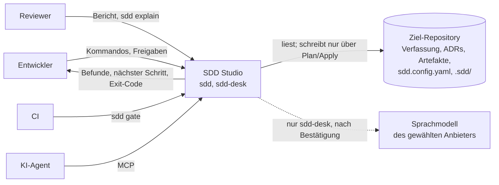
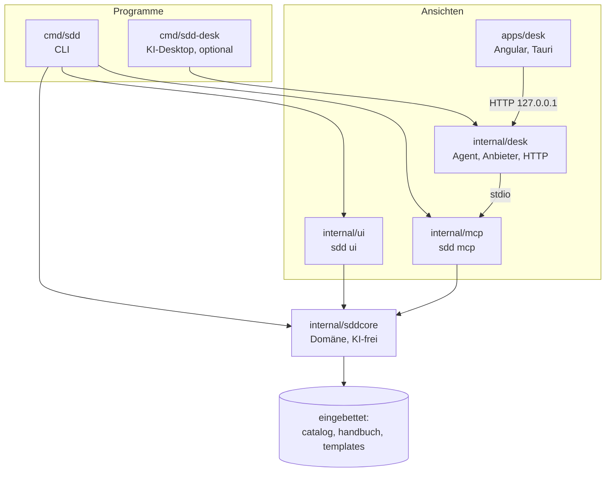
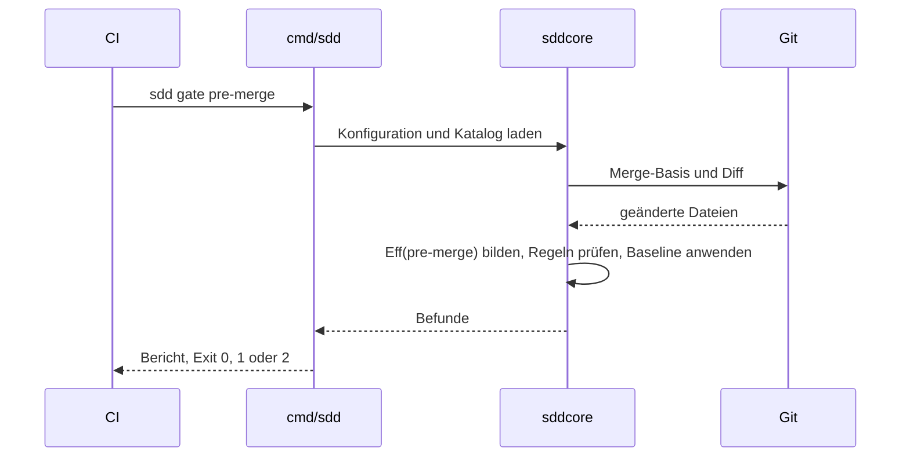
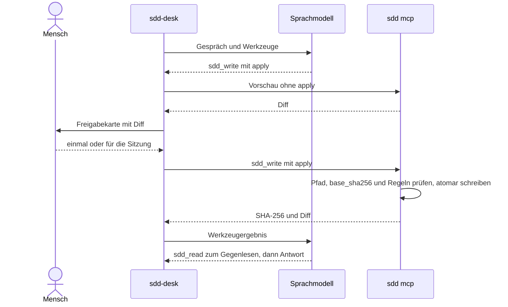
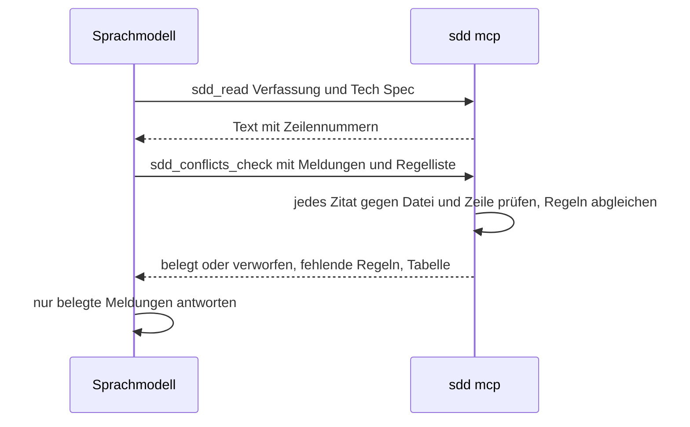
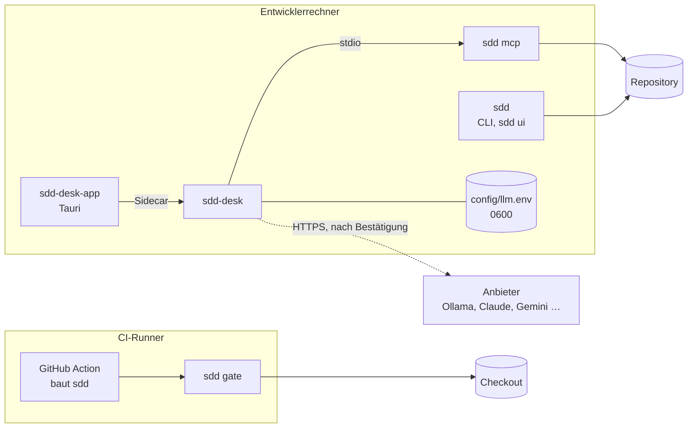

# Architekturdokumentation — SDD Studio (arc42)

Stand: Release v0.6.0 (Regelkatalog `1.2.0`, 23 Regeln). Gliederung nach dem [arc42](https://arc42.org)-Template 9.1 (© Dr. Peter Hruschka, Dr. Gernot Starke und Mitwirkende), lizenziert unter [CC BY-SA 4.0](https://creativecommons.org/licenses/by-sa/4.0/); Überschriften ins Deutsche übertragen. Diese Seite fasst zusammen und verweist; maßgeblich bleiben [Verfassung](../constitution.md), [ADRs](adr/), [Konzept](sdd_konzept.md) und [Handbuch](../handbuch/).

# Einführung und Ziele {#section-introduction-and-goals}

SDD Studio setzt Spec-Driven Development durch: Ein Projekt hält dauerhafte Regeln (Verfassung, ADRs) getrennt von temporären Arbeitsartefakten (PRD, Tech Spec, Plan), und drei Gates prüfen das maschinell statt per Disziplin. Leitidee: **ein Regelkatalog, zwei Ausgaben** — das Handbuch erklärt ihn, das Programm setzt ihn durch, und beide werden gegeneinander geprüft.

## Aufgabenstellung {#_requirements_overview}

- **Prüfen:** `sdd lint` und `sdd gate pre-implementation | pre-merge | pre-release` gegen den Regelkatalog (`catalog/catalog.yaml`), lokal und in CI (`action.yml`).
- **Bestand heben:** `sdd adopt` übernimmt ein gewachsenes Projekt auf einem eigenen Branch; Altbefunde landen in einer gate-gebundenen, nur schrumpfenden Baseline (Ratchet).
- **Führen:** `sdd next` nennt den nächsten Prozessschritt je Feature (Idee → PRD → Tech Spec → Plan → Tests → Umsetzung → Gate → Merge → Release → Archiv).
- **Anlegen und abschließen:** `sdd init`, `sdd new` (auch die Architekturdoku nach arc42: `sdd new --type arc42`), `sdd archive`.
- **Assistieren (optional):** `sdd mcp` stellt die Funktionen Agenten bereit; der getrennte KI-Desktop `sdd-desk` führt mit einem Sprachmodell durch den Prozess.

## Qualitätsziele {#_quality_goals}

| Priorität | Qualitätsziel | Bedeutung |
|---|---|---|
| 1 | **Determinismus** | Ein `error` beruht auf einem beschriebenen Prüfvertrag; gleicher Stand ergibt gleiche Befunde. Heuristiken höchstens `warn`. |
| 2 | **Unumgehbarkeit der Bremse** | Was ein Gate bestehen lässt, entscheidet kein Modell und keine bequeme Abkürzung: `baseline: forbidden`, `pinned`, kritische Aktionen nur einzeln bestätigt. |
| 3 | **Offline und vertraulich** | `sdd` baut keine ausgehenden Verbindungen auf und enthält keinen LLM-Code; keine Telemetrie. |
| 4 | **Einsetzbarkeit in Bestandsprojekten** | Erster Gate-Lauf auf einem gewachsenen Projekt ohne neue `error` für Bestandsarbeit; kein Datenverlust beim Übernehmen. |
| 5 | **Entfernbarkeit** | Dateien sind der einzige Zustand; ohne das Werkzeug bleibt alles lesbar und gültig. |

## Stakeholder {#_stakeholders}

| Rolle | Erwartung |
|---|---|
| Entwickler in Zielprojekten | Klare Regeln, wenige Fehlalarme, schneller Hinweis auf den nächsten Schritt. |
| Reviewer / Tech Lead | Nachvollziehbare Abweichungen: jede Verfassungs- oder Konfigurationsabschwächung mit ADR. |
| CI-Betreiber | Ein Binary, Exit-Codes `0`/`1`/`2`, ein GitHub-Action-Schritt. |
| Nutzer des KI-Desktops | Geführte Abläufe, deren Ergebnisse auf der Platte landen und deren Erfolg belegt ist. |
| KI-Agenten (Claude Code, Codex, Gemini CLI, Copilot) | Werkzeuge über MCP und Agenten-Dateien (`AGENTS.md`), die Verfassung und Ablauf nennen. |
| Maintainer von SDD Studio | Katalog, Handbuch und Prüfkern laufen nie auseinander (Selbstschutzregeln). |

# Randbedingungen {#section-architecture-constraints}

- **Verfassung** ([`constitution.md`](../constitution.md)): headless zuerst, Schichten `cmd/` ↔ `internal/sddcore`, Dateien als einziger Zustand, offline, Pfadsicherheit, Git nur lesend mit zwei Ausnahmen (`adopt --apply`, `init --git`), keine Regel ohne Prüfvertrag und Handbuchabschnitt.
- **Sprache:** Go für Kern, CLI, `sdd ui`, `sdd mcp` und `sdd-desk`; Angular für die Oberfläche des Desktops; Tauri 2 (Rust) nur als Hülle der Desktop-Anwendung.
- **Sprachneutralität der Zielprojekte:** Prüfungen arbeiten auf Pfaden, Git-Diffs, Frontmatter und Textmustern, ohne Compiler oder AST.
- **Git über die CLI**, keine eingebettete Implementierung.
- **Plattformen:** Linux geprüft (`.deb`); macOS, Windows, `.rpm`, AppImage ungetestet.
- **Dokumentsprache** Deutsch; Code-Kommentare und Commit-Nachrichten Englisch.

# Kontextabgrenzung {#section-context-and-scope}

## Fachlicher Kontext {#_business_context}

| Partner | Eingabe | Ausgabe |
|---|---|---|
| Mensch (CLI, `sdd ui`) | Kommandos, Freigaben | Befunde, Pläne, Berichte |
| CI | `sdd gate <gate>` | Exit-Code, Befunde (Text oder JSON v1) |
| KI-Agent | MCP-Aufrufe | Werkzeugergebnisse (strukturiert) |
| Sprachmodell (nur `sdd-desk`) | Werkzeugergebnisse, Gespräch | Vorschläge und Werkzeugaufrufe, die der Mensch freigibt |

## Technischer Kontext {#_technical_context}

| Kanal | Technik | Richtung |
|---|---|---|
| Dateisystem des Repositorys | lokale Dateien, nur unterhalb der Wurzel, keine Symlinks nach außen | lesen; schreiben nur über Plan/Apply |
| Git | `git` CLI (diff gegen Merge-Basis, show, init/commit nur in den Ausnahmen) | überwiegend lesend |
| `sdd ui` | HTTP auf `127.0.0.1`, Host-/Origin-Prüfung, Sitzungstoken | Browser ↔ `sdd` |
| `sdd mcp` | Model Context Protocol über stdin/stdout | Agent ↔ `sdd` |
| `sdd-desk` | HTTP auf `127.0.0.1` (Oberfläche), stdio zu `sdd mcp`, HTTPS zum gewählten Anbieter (Ollama lokal/Cloud, Claude, Gemini, OpenRouter, NVIDIA) | einzige ausgehende Verbindung des Systems |
| CI | GitHub Action `action.yml` baut `sdd` und ruft `sdd gate` | — |

# Lösungsstrategie {#section-solution-strategy}

| Ziel | Ansatz |
|---|---|
| Determinismus | Regelkatalog mit Prüfvertrag je `error`-Regel; Selbstschutzregeln SDD-070 – SDD-073 prüfen Katalog, Handbuch und Implementierung gegeneinander. |
| Bestand ohne Wand aus Altbefunden | Gate-gebundene Baseline mit `content_hash` und `ordinal`, nur schrumpfend; Profile `minimal` < `standard` < `regulated`. |
| Gate 1 ohne Implementierung | Erklärte Änderungsabsicht (`touches`) statt leerem Diff; Feature-Auflösung fail-closed. |
| Unumgehbare Bremse | `baseline: forbidden`; ADR-Pflicht für Verfassungs- (SDD-010) und Konfigurationsabschwächung (SDD-012, `pinned`); unveränderliche ADRs mit Lockfile (SDD-011). |
| KI ohne Kontrollverlust | `sdd` bleibt KI-frei; der Desktop ist ein getrenntes Programm, das ausschließlich `sdd mcp` nutzt — mit drei Freigabestufen (ADR 0003, 0004). |
| Entfernbarkeit | Plaintext-Artefakte, versionierte Konfiguration und Baseline; kein verborgener Zustand. |

# Bausteinsicht {#section-building-block-view}

## Whitebox Gesamtsystem {#_whitebox_overall_system}

Begründung: Die Bibliothek ist die Wahrheit, jede Oberfläche (CLI, `sdd ui`, MCP, Desktop) nur eine Ansicht. `sdd-desk` importiert `sddcore` nicht direkt, sondern spricht `sdd mcp` an (Test `TestSddDoesNotImportDesk` sichert die Gegenrichtung).

| Baustein | Verantwortung |
|---|---|
| `cmd/sdd` | Kommandos parsen, Ausgabe, Exit-Codes `0`/`1`/`2`. |
| `internal/sddcore` | Gesamte Domänenlogik, ohne Netz und ohne LLM. |
| `internal/ui` | `sdd ui`: eingebettete Weboberfläche, Schreiben nur über Plan/Apply. |
| `internal/mcp` | `sdd mcp`: 20 Werkzeuge (mit `--allow-critical`), geführte Prompts, Ressourcen; Pfadschutz und Freigabeschalter. |
| `internal/desk`, `cmd/sdd-desk` | Agentenschleife, Anbieter-Adapter, Freigabestufen, lokale HTTP-API; startet `sdd mcp --allow-write --allow-critical`. |
| `apps/desk` | Angular-Oberfläche (Gespräch, Freigabekarten, Prozessstand) und Tauri-Hülle mit `sdd-desk` als Sidecar. |
| `catalog/`, `handbuch/`, `templates/` | Regelkatalog, Handbuch mit Prüfverträgen, Artefakt-Templates — eingebettet in das Binary. `templates/arc42.md.tmpl` steht als einzige Datei unter CC BY-SA 4.0 (ADR 0006). |

### Schnittstellen {#_name_interface_1}

- **CLI** — Kommandos und Exit-Codes, Berichtsformat JSON `schema_version: 1`.
- **MCP** — Werkzeuge mit Ein-/Ausgabeschema; schreibend nur mit `--allow-write`, kritisch nur mit `--allow-critical`.
- **Desk-API** — `POST /api/turn[/stream]` mit `allowed_tools`, `allowed_writes`, `approved_calls`, `denied_calls`; Sitzungstoken.

## Ebene 2 {#_level_2}

### Whitebox *`internal/sddcore`* {#_white_box_building_block_1}

| Paket | Verantwortung |
|---|---|
| `catalog` | Regelkatalog laden (Datei oder eingebettet), Schweregrad je Gate, Profile, `pinned`. |
| `config` | `sdd.config.yaml` laden und validieren; ohne Konfiguration Exit 2. |
| `scan` | Artefakte, Frontmatter, Pfad-Globs, Git-Zugriff (Merge-Basis, Diff, `show`). |
| `rules` | Prüfungen je Regel, effektive Regelmenge je Gate (`Eff(g)`), Rückverfolgung AC → Tech Spec → Test → Task. |
| `baseline`, `adrlock`, `baselineplan` | Baseline anwenden und pflegen; ADR-Lockfile; Plan für `sdd baseline`. |
| `report` | Befunde, Berichtsformat v1. |
| `scaffold` | Pläne für `init`, `new`, `archive`, ADR-Entscheid, Agenten-Dateien; Apply mit Pfad- und Symlink-Schutz. |
| `guide` | `sdd next` (mit Projektschritten Verfassung, Übernahme, Architekturdoku), `sdd archive` (Testverweise, kein Entwurf). |
| `adopt` | Bestandsaufnahme, Reifegrad, Übernahme auf eigenem Branch. |
| `overview` | `sdd report`: Reifegrad, Gates, Schuldenstand. |

### Whitebox *`internal/mcp`* {#_white_box_building_block_2}

| Stufe | Werkzeuge |
|---|---|
| lesend | `sdd_next`, `sdd_lint`, `sdd_gate`, `sdd_report`, `sdd_explain`, `sdd_check_intent`, `sdd_context`, `sdd_trace`, `sdd_stack`, `sdd_read`, `sdd_validate_draft`, `sdd_conflicts_check` |
| schreibend (`--allow-write`) | `sdd_new`, `sdd_write` (Artefakte, Testdateien), `sdd_init`, `sdd_archive` |
| kritisch (`--allow-critical`) | `sdd_baseline`, `sdd_adr_accept`, `sdd_adopt_apply`, `sdd_config` |

Dazu geführte Prompts (`sdd-idea`, `sdd-requirements`, `sdd-techspec`, `sdd-adr`, `sdd-plan`, `sdd-adopt`, `sdd-start`, `sdd-constitution`, `sdd-arc42`, `sdd-tests`, `sdd-conflicts`, `sdd-review`).

# Laufzeitsicht {#section-runtime-view}

## Gate in CI {#_runtime_scenario_1}

1. CI ruft `sdd gate pre-merge` (über `action.yml`).
2. `config` lädt `sdd.config.yaml`, `catalog` den Katalog; `scan` bestimmt die Merge-Basis und den Diff.
3. `rules` bildet `Eff(pre-merge)` (Override oder `gate_default`, plus `pinned`) und führt jede Prüfung aus.
4. `baseline` markiert bekannte Altbefunde; `report` gibt Befunde aus. Exit `1` bei `error`, `0` sonst, `2` bei Konfigurationsfehlern.

## Schreibvorgang im KI-Desktop {#_runtime_scenario_2}

1. Das Modell ruft z. B. `sdd_write` mit `apply` auf.
2. `internal/desk` stuft den Aufruf ein (lesend / schreibend / kritisch). Ohne Freigabe holt es mit `apply: false` die Vorschau (Diff) und parkt den Aufruf als Freigabekarte.
3. Der Mensch erlaubt einmal, für die Sitzung (nur auf einer Karte, die den Schreibvorgang zeigt) oder lehnt ab; kritische Aufrufe nur einzeln.
4. `sdd mcp` prüft Pfad, `base_sha256` und Regeln und schreibt atomar über `scaffold`; das Ergebnis mit SHA-256 und Diff geht ins Gespräch.
5. Das Modell liest mit `sdd_read` gegen und meldet nur, was das Ergebnis belegt.

## Abgleich mit der Verfassung (`sdd-conflicts`) {#_runtime_scenario_n}

Das Modell liest Verfassung und Tech Spec, übergibt seine Meldungen strukturiert an `sdd_conflicts_check`; das Werkzeug prüft jedes Zitat gegen Datei und Zeile und nennt fehlende Regeln. Die Antwort zeigt nur belegte Meldungen. Das Ergebnis ist ein Hinweis, kein Befund.

# Verteilungssicht {#section-deployment-view}

## Infrastruktur Ebene 1 {#_infrastructure_level_1}

| Einheit | Inhalt | Ort |
|---|---|---|
| `sdd` | ein statisches Go-Binary mit eingebettetem Katalog, Handbuch, Templates und Weboberfläche | Entwicklerrechner, CI-Runner |
| `sdd-desk` | Go-Binary mit eingebetteter Angular-Oberfläche; findet `sdd` daneben oder im `PATH` | Entwicklerrechner |
| `sdd-desk-app` | Tauri-Anwendung mit `sdd-desk` und `sdd` (`sdd-studio-sdd`) als Sidecars | Entwicklerrechner (Linux `.deb` geprüft) |
| `config/llm.env` | Anbieter und Schlüssel, Rechte `0600`, nie im Projekt | neben `sdd-desk` bzw. `~/.config/io.github.zhengbote.sdddesk/` |

`make` baut alles, `make install` installiert lokal; CI nutzt `uses: Zheng-Bote/sdd_studio@<version>`.

# Querschnittliche Konzepte {#section-concepts}

## Dateien als einziger Zustand {#_concept_1}

Verfassung, Artefakte, `sdd.config.yaml`, `.sdd/baseline.json` und `.sdd/adr-lock.json` sind versioniert. Kein Cache und keine Sitzung ist Wahrheit.

## Plan/Apply und Pfadschutz {#_concept_2}

Jede schreibende Funktion erzeugt zuerst einen Plan (Vorschau mit Inhalt oder Diff), Apply schreibt nur diesen Plan: atomar, nie außerhalb der Repository-Wurzel, nicht über Symlinks nach außen, Ersetzen nur mit erwartetem Inhalt bzw. `base_sha256`.

## Freigabestufen {#_concept_3}

Lesend, schreibend, kritisch (ADR 0003). Eine Sitzungsfreigabe gilt nur für die Stufe der Karte, auf der sie erteilt wurde. Kritisch — Baseline, Lockfile, `adopt --apply`, ADR entscheiden, Konfiguration ändern (ADR 0004) — nur einzeln, nie für die Sitzung, nach Ablehnung keine erneute Anfrage im selben Zug.

## Selbstanwendung {#_concept_4}

SDD Studio wird mit sich selbst entwickelt: jedes Feature mit PRD und Tech Spec, Tests mit `// <slug> AC-<n>:`, `TestSelfDogfoodingClean` verlangt null Befunde auf dem eigenen Repository, Features werden beim Release archiviert.

## Sicherheit der lokalen Server {#_concept_5}

`sdd ui` und `sdd-desk` binden nur an `127.0.0.1`, prüfen `Host`, verlangen ein Sitzungstoken und setzen eine Content-Security-Policy ohne Inline-Skripte.

# Architekturentscheidungen {#section-design-decisions}

| ADR | Entscheidung |
|---|---|
| [0001](adr/0001-schreibender-git-zugriff-fuer-sdd-adopt.md) | `sdd adopt --apply` darf Git schreiben: sauberer Baum, neuer Branch, ein Commit je Schritt. |
| [0002](adr/0002-optionaler-ki-desktop-getrennt-vom-ki-freien-sdd.md) | Optionaler KI-Desktop getrennt vom KI-freien `sdd` (abgelöst durch 0003). |
| [0003](adr/0003-ki-desktop-darf-alle-sdd-aktionen-mit-freigabe.md) | Der Desktop darf alle `sdd`-Aktionen, freigegeben in drei Stufen. |
| [0004](adr/0004-konfiguration-aendern-ist-kritisch.md) | Konfiguration ändern ist im Desktop kritisch (`sdd_config`). |
| [0005](adr/0005-abschwaechung-der-konfiguration-braucht-ein-adr.md) | Abschwächung der Konfiguration braucht ein ADR (SDD-012, `pinned`). |
| [0006](adr/0006-arc42-template-unter-cc-by-sa-einbetten.md) | arc42-Template als eigenständige Datei unter CC BY-SA 4.0. |
| [0007](adr/0007-qualitaetsanforderungen-im-prd-mit-kennung-qa.md) | Qualitätsanforderungen im PRD mit stabiler Kennung `QA-<n>`; optionale Abschnitte, keine neue Pflichtregel. |

Weitere Richtungsentscheidungen ohne eigenes ADR stehen im [Konzept, Abschnitt 14](sdd_konzept.md).

# Qualitätsanforderungen {#section-quality-scenarios}

## Übersicht der Qualitätsanforderungen {#_quality_requirements_overview}

Die Qualitätsziele aus Abschnitt 1 werden durch Selbstschutzregeln, Tests mit Mutationsprüfung der Schutzmechanismen und das Dogfooding abgesichert. Erfolgskriterien: [Konzept, Abschnitt 13](sdd_konzept.md).

## Qualitätsszenarien {#_quality_scenarios}

| Ziel | Szenario | Erwartete Reaktion |
|---|---|---|
| Determinismus | Gleicher Stand, zwei Läufe | Identische Befunde und Hashes. |
| Unumgehbarkeit | Ein Branch setzt `profile: minimal` und `override: [SDD-001]` | `sdd gate pre-merge` meldet SDD-012; der Override schaltet die Regel nicht ab. |
| Unumgehbarkeit | Das Modell will die Konfiguration ändern, `sdd_write` ist für die Sitzung freigegeben | `sdd_write` lehnt ab; `sdd_config` wartet auf einzelne Bestätigung mit Befund-Differenz. |
| Offline | Lauf ohne Netz | `sdd` funktioniert vollständig; ein Test verbietet Code für ausgehende Verbindungen. |
| Bestand | Erster Gate-Lauf nach `sdd adopt` | Null neue `error` für Bestandsarbeit in `pre-implementation`/`pre-merge`. |
| Wahrhaftigkeit der KI | Ein Schreibvorgang scheitert | Das Modell erkennt es am Werkzeugergebnis bzw. am unveränderten Hash und meldet keinen Erfolg (Live-Test 2026-11-05). |

# Risiken und technische Schulden {#section-technical-risks}

- **Lücken in SDD-012:** `tests.include`, `artifacts.*`, `base_ref` und `constitution_sections` werden außerhalb des Desktops nicht auf Abschwächung geprüft (ADR 0005, Entscheidung 3).
- **Kleine lokale Modelle** halten Form- und Zitierregeln weniger zuverlässig ein; `sdd_conflicts_check` fängt Zitate ab, die Bewertung bleibt beim Menschen.
- **Übersprungene Tests** zählen für SDD-022 als Testverweis; ob ein Test wirklich läuft, prüft `sdd` sprachneutral nicht.
- **Kein Commit-Werkzeug im Desktop:** Nach einem Ablauf committet der Mensch selbst.
- **Plattformen:** Desktop-Anwendung außerhalb von Linux `.deb` ungetestet.
- Weitere Risiken und Gegenmaßnahmen: [Konzept, Abschnitt 12](sdd_konzept.md).

# Glossar {#section-glossary}

| Begriff | Definition |
|---|---|
| Verfassung | Systemweite, dauerhafte Regeln des Projekts (`constitution.md`); Änderung nur mit ADR (SDD-010). |
| ADR | Architecture Decision Record unter `docs/adr`, `NNNN-*.md`; nach `accepted` unveränderlich (SDD-011). |
| PRD / Tech Spec / Plan | Feature-Artefakte: Anforderungen mit `AC-<n>`, technische Umsetzung, Tasks. |
| Gate | Freigabeschritt `pre-implementation`, `pre-merge`, `pre-release`. |
| `Eff(g)` | Effektive Regelmenge eines Gates: Override oder `gate_default`, plus `pinned`-Regeln. |
| Baseline | Gate-gebundene Liste bekannter Altbefunde in `.sdd/baseline.json`; nur schrumpfend (Ratchet). |
| `pinned` | Katalogattribut: Regel läuft in ihren Gates trotz Override; verlangt `profile: minimal` und `baseline: forbidden`. |
| `QA-<n>` | Kennung einer messbaren Qualitätsanforderung im PRD (ADR 0007); braucht keinen Testverweis. |
| Architekturdoku | Diese Seite bzw. `artifacts.architecture` eines Projekts (Standard `docs/arc42.md`); `release:` nennt den beschriebenen Stand. |
| `touches` | Erklärte Änderungsabsicht eines Features (Pfad-Globs); Grundlage für Gate 1 und SDD-024. |
| Profil | `minimal` ⊂ `standard` ⊂ `regulated`: welche Regeln aktiv sind. |
| Prüfvertrag | Deterministische Beschreibung, wann eine `error`-Regel greift (Handbuch). |
